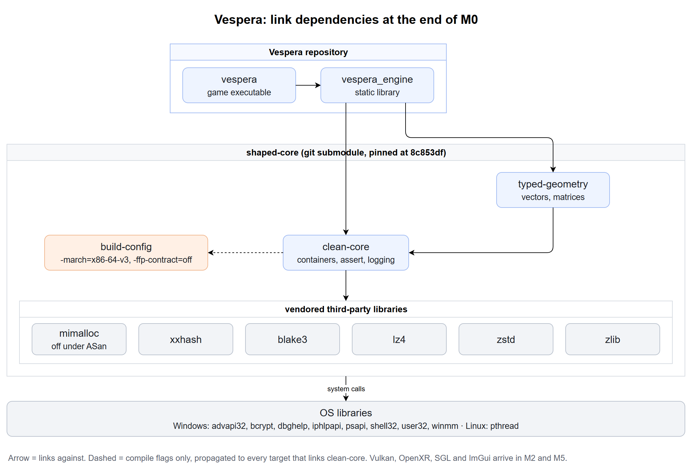

# The Vespera project

A long time ago I was working on a step-by-step walkthrough of making a custom game engine, both to explain in detail the steps involved and to clarify the architecture to myself. This is a continuation of that work, where I return to diving into all the steps involved in making a fully custom game engine, with corresponding high performance targets.

Recently I've acquired a Steam Frame VR headset, which is a good target platform to keep in mind - VR has very tight constraints on the frame rate. I still would like to have pretty shiny graphics, so I'm going to target it via the streaming wifi adapter from a desktop computer. I'm treating this the way a solo developer would, which mostly has consequences for what the asset pipeline looks like - heavily lean on procedural generation, but I'd still like to be able to be in control and author stuff as needed. For VR the guideline is to achieve a framerate of 90 fps, which is challenging.

The theme of control also applies to the library stack we'll use - keep a pretty minimal list of dependencies, although I would like to be relatively flexible in what platform to target. Some colleagues of mine authored the shaped-core libraries and its new SGL shading language and this is a good opportunity to become acquainted with it. At the very least I'd like to target Windows and Linux platforms. The small list of dependencies is listed below.

Everything else will be implemented by hand, which should be very informative. I'm going to use C++23 with all of the latest tricks that enables, which should be interesting and educational.

As for the game that will be developed on top of this engine - it's going to be a VR-first bullet hell. A kind of mix between Tempest, Star Fox, Wipeout, Thumper and Returnal. People tell me Rez comes close, though I've never played it, and it sounds pretty fun to me. Tempest has some excellent aesthetics that could use a more modern take, and I've always enjoyed the general atmosphere of Wipeout. Importantly, the models involved are relatively simple so we don't have to implement character animation and such. From Star Fox I'd like to borrow the concept of an on-rails shooter. Thumper has a kind of rhythmic pulsing gameplay that I'd like to try and replicate, with a sense of speed that was an excellent experience in VR. Finally the bullets as used in Returnal should make for an interesting challenge both in game design and in programming. I'm not entirely sure where this will end up, but it feels like this could be something good.

## Goals

- Vespera should be playable in a Steam Frame via SteamVR streaming, from a Windows or Linux PC using OpenXR
- It should also be playable without VR, on a monitor with a gamepad, or keyboard+mouse
- Both Windows and Linux are treated as equal first-class platforms. Both are built and tested in CI.
- In VR we should have a steady 90 Hz framerate (11.1 ms per frame), configurable upward. Dropped frames are comfort bugs.
- Music time is used as the game master clock - gameplay events land on musical positions and gameplay feeds back into the music.
- We'll make use of procedural generators for level geometry, ships, enemies, palettes, drum one-shots and synth sounds. Each is deterministic from a seed plus parameters, and live-tunable in an in-engine editor.
- Every milestone is reported on as a blog post

## Non-goals

- We're not aiming to run natively on the headset itself
- D3D12, Metal, WebGPU, macOS, mobile rendering targets are not in scope
- We don't need a general-purpose scene editor or imported-art pipeline. Maybe we'll need a glTF importer
- We're not doing multiplayer, no networking

## Anti-goals

- We'll only develop engine features that are actually used (YAGNI)
- We're not making abstraction layers with just one implementation.
- Frame-time spikes or judder is unacceptable in VR. Any system that can't hold the frame budget is redesigned.
- The engine should not be aware of the game itself. Game specifics live in the game target
- The codebase must always remain fully explainable without an AI assistant

## Constraints

- The main programming language is C++23
- The build system is CMake 3.28 or higher
- Dependencies are kept minimal:
  - **shaped-core** (MIT) as a foundational library
  - **Vulkan SDK / loader**
  - **OS APIs** for the window, input and audio
    - Windows: Win32, Raw Input, XInput, WASAPI
    - Linux: X11 through xcb, evdev, ALSA
- Minimum CPU target: x86-64-v3 (which enables AVX2 instructions)

At this point we have a tech stack, a set of platform requirements and a rough game outline. Now the overall approach - I'd like to have a clean layered architecture for the game engine itself, but at the same time I'd like to have something playable as soon as possible. That's the approach - build minimal layers to achieve a vertical game slice, then widen as needed to improve the final product. I'm going to use AI models mostly to check my work and verify that it's going in the right direction, but all of the C++ code will be hand-written so that I deeply understand everything that was written; I've delegated the build plumbing and CI scripts.

With that we make a roadmap:

# Vespera roadmap

- M0 Foundation
  - Create repository layout
  - Set up the vespera_engine as a static library, with an executable game vespera
  - Set up unit tests, CI workflow
  - Bring in shaped-core as a submodule
  - Make sure to have Windows and Linux platform layers
  - Provide initial basis: arena allocator, engine entry point, initialization/shutdown, assertion, logging
- M1 Window and input
  - Create a native window on Win32 and xcb
  - Handle keyboard, mouse and gamepad: XInput on Windows, evdev on Linux
  - Run a fixed-step main loop
- M2 Pixels on the screen
  - Create a Vulkan device and swapchain on the main window
  - Clear the screen, draw a triangle using an SGL shader compiled to SPIR-V
  - Set up shader hot-reloading
  - Draw an ImGui overlay through a custom platform backend
- M3 Flat slice
  - Make a chase camera that follows the ship
  - Make a spline rail that guides the level
  - Set up a procedural wireframe landscape ~ terrain from heightfield plus a grid of city blocks
  - Enable twin-stick steering and aiming through an action layer
  - Make a single enemy that fires a dense bullet pattern
    - Store the bullets in a structure-of-arrays for at least 10k live bullets
    - Draw all bullets in a single instanced draw call
    - Perform collision detection against the ship's hitbox
    - Player shots are tested only against enemies
    - Bullet processing should have a timing budget of around 1 ms
- M4 Sound and clock
  - Set up audio output: WASAPI on Windows, ALSA on Linux
  - Create an audio thread and mixer
  - Create a sampler playing one drum loop
  - Set up a music clock, with latency calibration
  - Make the enemy fire on the beat
- M5 The VR slice
  - Start an OpenXR session through SteamVR
  - Draw both eyes in a single view-instanced pass
  - Map the twinstick controls onto the Steam Frame controllers' thumbsticks
  - Work through comfort basics for a chase cam
  - Make sure the vertical slice is fully playable in the Steam Frame
- M6 Deepening: graphics
- M7 Deepening: sound
- M8 Deepening: authoring
- M9 Deepening: gameplay
- M10 Deepening: performance
- M11 Polish and shipping

# M0 Foundation

All things start with the foundation, but sadly there is nothing really visible yet. We just get started creating a fresh repository that builds on two operating systems, and add a test setup. We want to have something to test, so we add a couple of engine pieces. Writing the cmake files and CI scripts takes more time than the rest of the code, and pretty much all of my time was spent making sure the code behaves the same everywhere. It's worth showing, because it's the work every engine needs before anything else.

## Bringing in shaped-core

shaped-core goes in as a git submodule pinned to one commit, and CMake configures only the libraries Vespera actually uses: for now `clean-core` (containers, asserts, logging) and `typed-geometry` (vectors and matrices). There are more libraries that we may add to that list in later milestones. Right off the bat, 4 things went wrong:

**The C compiler nobody named.** shaped-core vendors a few C libraries (xxhash, zstd), so CMake enables the C language too. My presets only named a C++ compiler, so on Windows CMake picked the GNU-style `clang.exe` for C and handed it MSVC-style flags. The error was `/DWIN32: no such file or directory`: a flag being read as a file name. The fix is one line per preset, naming the C compiler as well.

**Compiler versions.** Ubuntu 24.04's default Clang 18 lacks `std::hardware_destructive_interference_size`, which clean-core uses to keep threads from fighting over cache lines. It arrived in Clang 19. Instead of letting that fail deep inside a library header, the configure step now checks the Clang version and stops with a message saying what to install. CI now builds Linux with Clang 21, the same as shaped-core itself.

**A tiny bug in clean-core.** On Linux, clean-core's thread-naming code uses `isize` without its `cc::` namespace. The macOS branch of the same function had already been fixed; the Linux branch hadn't. Before deciding how to handle it, I checked shaped-core's own CI at that commit. It was red for the same reason, which settles whose bug it is. I didn't patch the submodule, since a local edit there is easy to lose and hard to notice. Instead, one header was force-included into clean-core's own sources on Linux to bring `cc::isize` into scope, marked for deletion once the fix landed upstream. It landed upstream that same afternoon, so the pin moved to `c6c96c7` and the workaround is gone.

**Windows CI that never finished.** The Windows job sat "in progress" for hours. The cause was the Debug C runtime: when `abort()` runs and there's no console attached, it shows a modal Abort/Retry/Ignore dialog. CI has no one to click it. The death test, which deliberately fails an assert to prove asserts work, waited on a dialog nobody could see. One call to `_set_abort_behavior` at startup turns the dialog off. Locally that test went from 2.7 s to under 0.3 s, a clear signal that the problem has been resolved.

## What linking a library does to your build

Asking shaped-core to use two libraries pulls in more than that. This is everything the game links at the end of M0:

clean-core brings six vendored libraries, compiled from source inside the submodule so nothing is downloaded at build time, plus a handful of OS libraries. The orange box isn't a library at all, but a set of compile flags.

Linking clean-core also brings in its build settings: `-march=x86-64-v3`, `-ffp-contract=off` and frame pointers. On x86, the first flag makes AVX2 the minimum CPU for the whole game (the ARM64 build doesn't get it), which is a shipping decision. It's probably fine. Every desktop CPU since Intel's Haswell (2013) and AMD's Excavator (2015) has AVX2, and none of the older ones will drive 90 Hz VR at these settings. Also when we get to the bullet simulation, we can make good use of it. `-ffp-contract=off` stops the compiler from fusing multiplies and adds, so floating-point results don't change with the optimizer. For us, that matters for the procedural generators, which must produce the same level from the same seed on all platforms. It isn't enough on its own, though: `sin`, `cos`, `exp` and `pow` come from a different C runtime on each OS and can differ in the last bit, so the generators will need their own versions of those.

CI builds and tests three configurations: Windows, Linux with AddressSanitizer, and Linux on ARM64 as a native runner, the same way shaped-core tests itself. ASan needs clean-core's mimalloc allocator turned off, because the leak checker can't see memory mimalloc hands out.

## Swapping my asserts and logger for clean-core's

Initially I had my own assert and logger. Once shaped-core was in, keeping both would mean two ways to do the same thing, so I switched to clean-core's. This was a very small migration, with three changes in behavior:

- `CC_ASSERT` stays on in Debug **and** RelWithDebInfo, and only goes away in Release. My old assert went away whenever `NDEBUG` was defined, which includes RelWithDebInfo. Profiling builds now pay for their asserts. This is fine, just a slight change in expectations. 
- Assert messages must be string literals, which keeps the header cheap to include everywhere. Formatted messages use a separate `CC_ASSERTF`.
- Logging is a real subsystem: every log line is an event in one stream, alongside profiling data, and printing is just one listener on that stream. A library may never switch recording on, because how much memory it uses is the program's decision. So until the program installs a listener, logging prints nothing.

That last point is why Vespera now has an `Engine` object. Already we have a bit of initialization/shutdown ceremony and it's almost always better to wrap that in a class. The engine constructor turns off the abort dialog, enables the engine's logging domain and installs the console listener. Its destructor unregisters the listener and shuts recording down, so we have a clean shutdown as well.

## The smallest test that found a real bug

The final M0 step split the engine library (`vespera_engine`) from the game executable (`vespera`), and added one test: start the game and expect it to exit cleanly. That test failed on its first run. Installing the console listener starts a background thread. When `main` returned without stopping it, a global thread object was destroyed while still running, and clean-core asserts on exactly that. clean-core's documentation says a program that runs until it exits can skip shutdown; it can't, and I've reported that upstream.

The fix was the `Engine` destructor above, and the order is also important: unregister the listener first, then shut down, or shutdown asserts that a listener is still registered. Two lessons for a tiny test that checks so little: a smoke test of "start and exit" catches problems at the edges of the program that unit tests never reach, and a failure that only happens at exit is much cheaper to find in M0 than once there are a dozen subsystems shutting down.

## Where M0 ends

M0 ends with an engine library, a game executable that starts, logs `Vespera 0.1.0` and exits cleanly, an arena allocator with tests, and CI green on Windows, Linux and ARM64 Linux. Nothing on screen yet, which is our next stop: a native window and input, written directly against Win32 and xcb.

# Epilogue

Enjoy the ride, we're going to have some fun here :)